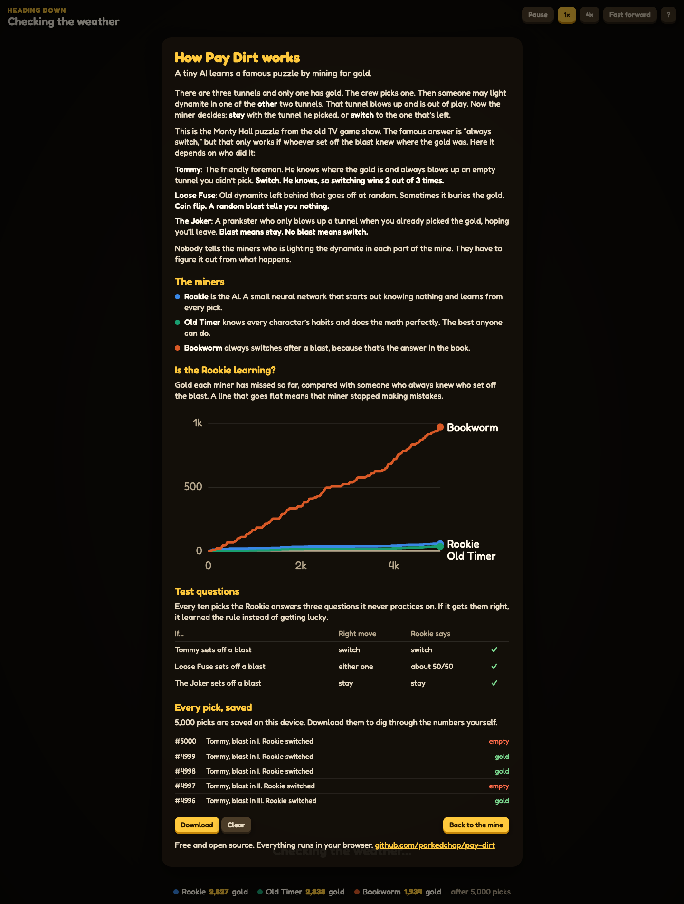

# Pay Dirt

A little AI learns a famous puzzle by mining for gold, live in your browser.


## The idea in one minute

Three tunnels. One has gold.

The crew picks a tunnel. Then someone may light dynamite in one of the **other** two tunnels. Boom, that tunnel is blocked and out of play. Now the miner decides: stay with his tunnel, or switch to the one that's left?

That's the **Monty Hall puzzle** from the old TV game show. Most people learn the answer is "always switch." But that's only true because the host *knows* where the prize is. Change who sets off the blast, and the right answer changes too.

| Who lights the dynamite | What they're up to | Right move |
|---|---|---|
| **Tommy** | The friendly foreman. He knows where the gold is and blows up an empty tunnel. | Switch (wins 2 out of 3 times) |
| **Loose Fuse** | Old dynamite going off at random. Sometimes it buries the gold. | Doesn't matter, it's a coin flip |
| **The Joker** | A prankster who only blows up a tunnel when you already picked the gold, hoping you'll leave. | Stay after a blast, switch when there's none |

Nobody tells the miners who is lighting the dynamite in the part of the mine they're in. They have to figure it out from what happens.

## Who's playing

Three miners stand in the same spot, see the same first pick, and see the same blast. The only difference is what they do next.

- **Rookie** is the AI. A tiny neural network (162 numbers) that starts out knowing nothing. Nobody tells it the rules or who the characters are. It watches what happens and learns.
- **Old Timer** knows every character's habits and does the math perfectly. He's the best anyone can do.
- **Bookworm** always switches after a blast, because that's the textbook answer. It's what an AI does when it memorized the famous puzzle instead of thinking about it.

## Walkthrough

**1. A part of the mine ends.** The camera moves in close and shows how everyone did. Here it was Loose Fuse, which is pure luck, so nobody did much better than anyone else.


**2. The next part gets shuffled.** This is where the randomness comes from: the real weather in a mining town right now, scrambled into a number. That number secretly decides who's lighting the dynamite, how long this part lasts, and where the gold is.


**3. The crew picks a tunnel.** Top left shows the town whose weather shuffled this part, and Old Timer's guess for who is behind the dynamite.


**4. Someone lights dynamite in another tunnel.** Boom.


**5. The headlamp checks the rubble.** That tunnel is blocked, so two are left.


**6. Everyone decides.** The colored lights show where each miner is going, and the headlamp shows the Rookie's choice. Old Timer is sure this is the Joker, so he stays. The Rookie figured out the same thing. The Bookworm switches, which is exactly what the Joker wanted.


**7. The gold is revealed** and the score at the bottom updates.


**8. The ? button** explains the rules and shows whether the Rookie is learning: a chart of gold missed over time, three test questions, and every pick saved to your device.



It works on a phone too.


## How we know it's really learning

Because we built the mine, we always know the right answer at every fork. So every fork is a free test, forever.

- **Gold missed.** For every pick, we compare the miner's choice to someone who knew exactly who set off the blast. A line that goes flat means that miner stopped making mistakes. We count the odds, not the luck, so a lucky guess doesn't hide a bad choice.
- **Test questions.** Every ten picks the Rookie answers three questions it never practices on, one per character. Getting them right means it learned the rule.
- **Automatic checks.** The tests double check the AI's math and fail if the Rookie stops learning.

What it shows so far (5,000 picks, measured over the last 1,000):

| Miner | Gold missed per 100 picks |
|---|---|
| Old Timer | 0.1 |
| Rookie | 0.7 |
| Bookworm | 15.5 |

The Rookie gets close to Old Timer within a couple thousand picks. The Bookworm never improves, because the Joker fools it every single time.

## Where the randomness comes from

Cloudflare famously keeps a wall of lava lamps and turns photos of them into random numbers. Pay Dirt does the same thing with the weather.

One free request to [Open-Meteo](https://open-meteo.com) (no account, no key) gets the current weather in eight real mining towns: St Just (England), Kiruna (Sweden), Potosí (Bolivia), Kalgoorlie (Australia), Butte (USA), Wieliczka (Poland), Calama (Chile) and Falun (Sweden). Each part of the mine takes the next town's reading and scrambles it with SHA-256 into a random number. That number decides who's lighting the dynamite, how long that part of the mine lasts, and where the gold goes. The weather is checked again every 15 minutes.

The weather also changes how the cave looks: more drips when it's raining, more fog when it's humid, dust blowing when it's windy.

## Run it

You don't need to install anything:

```sh
cd web && python3 -m http.server 8000
# then open http://localhost:8000
# http://localhost:8000/#turbo starts in fast forward
```

Replay an exact run (handy for bug reports and screenshots): `http://localhost:8000/?seed=7&skip=1209&freeze=calls`. The freeze points are `pick`, `boom`, `blast`, `calls`, `reveal`, `done` and `shuffle`.

## Every pick, saved

Every pick is saved in your browser, so it survives a reload. The **Download** button (under **?**) gives you all of it as a JSONL file: who was behind the dynamite, which tunnel blew up, each miner's choice and how sure it was, and whether it found gold.

To make a big log without the animation:

```sh
node tools/dig.mjs --forks 20000 --every 1000 --out runs/today.jsonl
```

It prints a progress line every 1,000 picks so you can watch it learn.

## Bring your own AI

For people who want to train their own agent, the same mine is in Python as a [Gymnasium](https://gymnasium.farama.org) environment. Action 0 stays, 1 switches, and you get a reward of 1 for gold.

```python
from pay_dirt.env import KnockersEnv

env = KnockersEnv(episode_forks=2000)
obs, info = env.reset(seed=0)
obs, reward, terminated, truncated, info = env.step(1)
info["regret"]   # gold missed compared to knowing who set off the blast
```

Score it the same way the page does:

```sh
cd python && pip install -e ".[test]"
python -m pay_dirt.evaluate --policy bookworm --forks 3000 --seeds 5
python -m pay_dirt.evaluate --policy my_pkg.agents:MyAgent --max-regret 2
```

The Python version makes exactly the same mine as the browser for the same seed, and a test checks that.

## Tests

```sh
npm test                      # the puzzle math, the AI's math, and is it still learning
cd python && pytest
```

## What it costs

Nothing. The AI trains on your own computer in plain JavaScript. There's no server, no GPU, no API key and no paid service.

## What's inside

```
web/sim.js          the mine, the three characters, and Old Timer's math
web/apprentice.js   the Rookie (the neural network) and its test questions
web/expedition.js   runs all three miners at the same forks and keeps score
web/entropy.js      the weather request and the random numbers
web/cave.js         the 3D cave (three.js)
web/log.js          saving every pick
web/main.js         the page
python/             the same mine for Python, plus the scorer
tests/              tests, and the trace Python has to match
tools/dig.mjs       a big run with no animation
```

## Thanks

[three.js](https://threejs.org), [Fredoka](https://fonts.google.com/specimen/Fredoka), [simplex-noise](https://github.com/jwagner/simplex-noise.js) and [Open-Meteo](https://open-meteo.com). "Monty Fall" comes from Jeffrey Rosenthal's *Monty Hall, Monty Fall, Monty Crawl*. The idea of something in the mine that may or may not be on your side comes from the Cornish "knockers" of mining folklore.

## License

MIT
