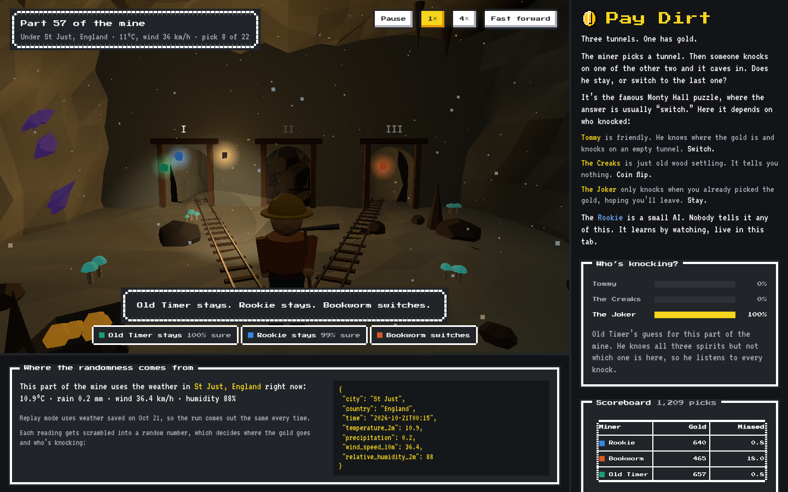
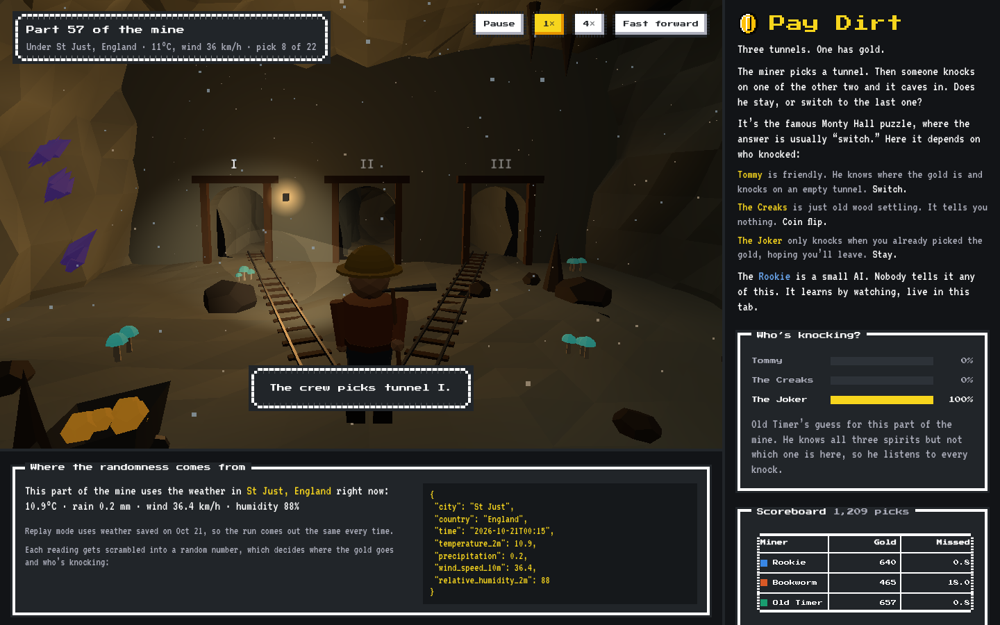
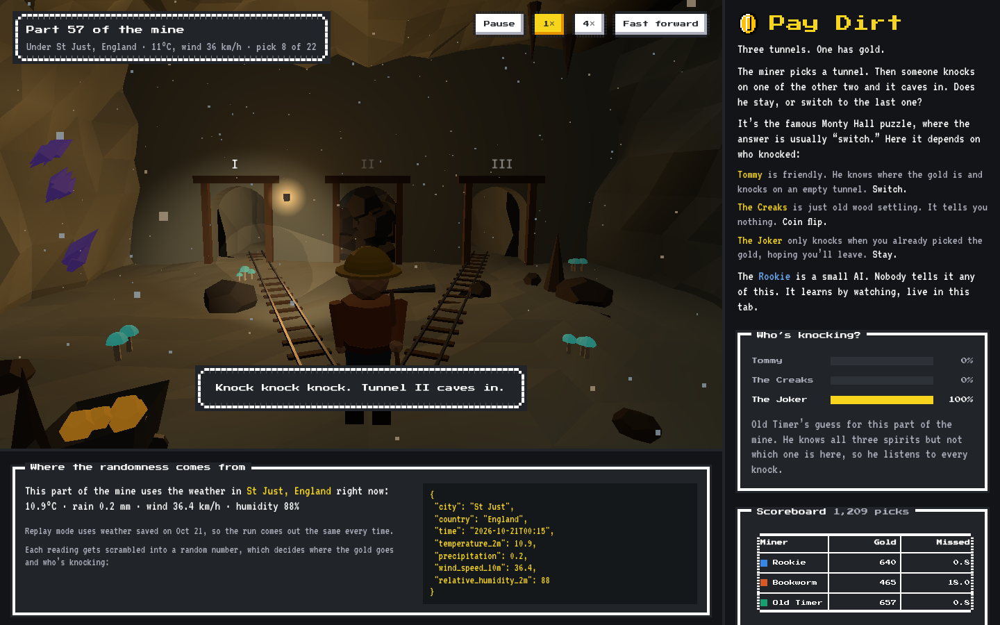
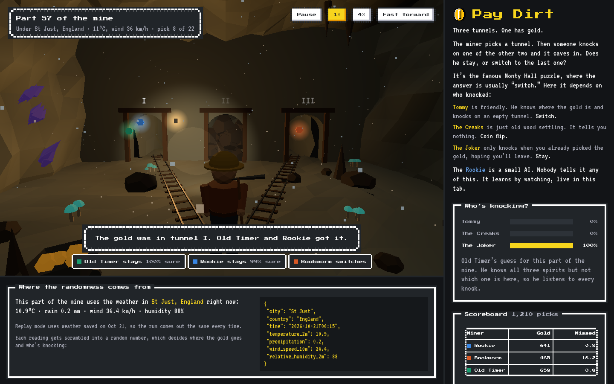
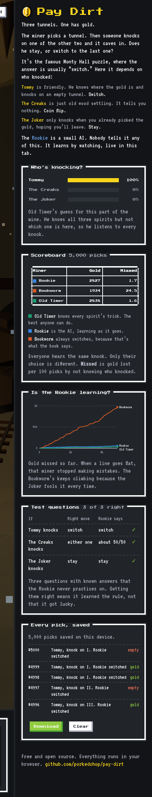
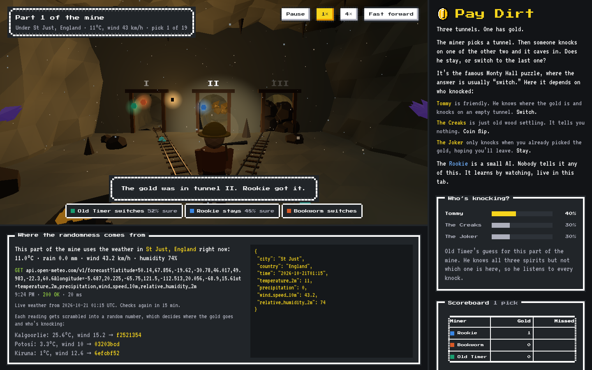
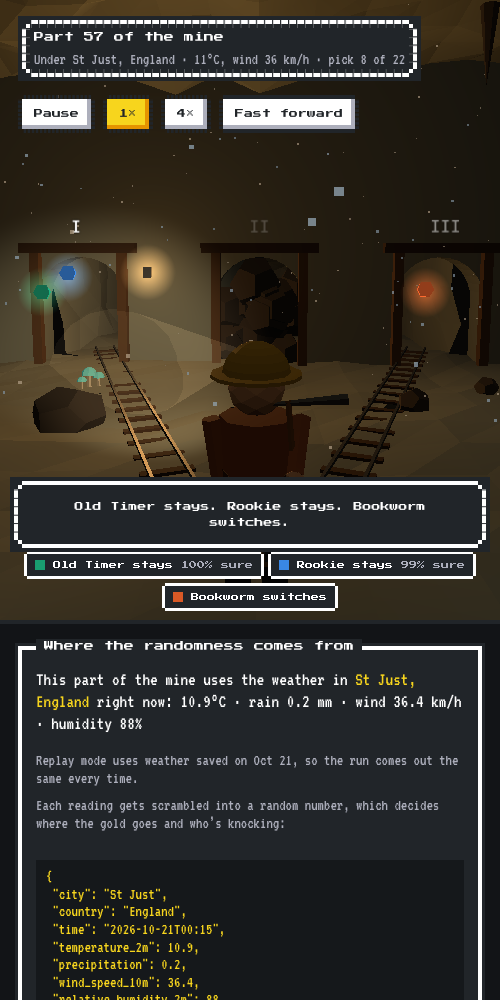

# Pay Dirt

A little AI learns a famous puzzle by mining for gold, live in your browser.



## The idea in one minute

Three tunnels. One has gold.

The miner picks a tunnel. Then someone knocks on one of the other two and it caves in. Does he stay with his pick, or switch to the last tunnel?

That's the **Monty Hall puzzle** from the old TV game show. Most people learn the answer is "always switch." But that's only true because the host *knows* where the prize is. Change who opens the door, and the right answer changes too.

Old Cornish miners believed spirits called *knockers* lived in the mines. So in Pay Dirt, three different things can knock:

| Who knocks | What they're up to | Right move |
|---|---|---|
| **Tommy** | Friendly. Knows where the gold is and knocks on an empty tunnel. | Switch (wins 2 out of 3 times) |
| **The Creaks** | Not a spirit at all, just old wood settling at random. Sometimes it lands on the gold and buries it. | Doesn't matter, it's a coin flip |
| **The Joker** | Only knocks when you already picked the gold, hoping you'll leave. | Stay when it knocks, switch when it's quiet |

Nobody tells you which one is haunting the part of the mine you're in. You have to figure it out from the knocks.

## Who's playing

Three miners stand in the same spot, see the same first pick, and hear the same knock. The only difference is what they do next.

- **Old Timer** knows every spirit's trick. He's the best anyone can do.
- **Rookie** is the AI. It's a tiny neural network (162 numbers) that starts out knowing nothing. Nobody tells it the rules or the spirits' names. It watches what happens and learns.
- **Bookworm** always switches when there's a knock, because that's the textbook answer. It's what an AI does when it memorized the famous puzzle instead of thinking about it.

## Walkthrough

**1. The crew picks a tunnel.** The top left shows which part of the mine you're in and which real town's weather shuffled it.



**2. Someone knocks, and a tunnel caves in.** On the right, Old Timer's guess for who is knocking. Here he's sure it's the Joker.



**3. Everyone decides.** The colored lights show which tunnel each miner chose. The Rookie and Old Timer stay. The Bookworm switches, which is exactly what the Joker wanted.


**4. The gold is revealed** and the scoreboard updates.



**5. Is it learning?** The side panel shows the scoreboard, a chart of gold missed over time, three test questions, and every pick saved to your device.



**6. Where the randomness comes from.** Under the cave you can see the real weather request and the numbers it returned.



It works on a phone too.



## How we know it's really learning

Because we built the mine, we always know the right answer at every fork. So every fork is a free test, forever.

- **Gold missed.** For every pick, we compare the miner's choice to someone who knew exactly which spirit was knocking. A line that goes flat means that miner stopped making mistakes. We count the odds, not the luck, so a lucky guess doesn't hide a bad choice.
- **Test questions.** Every ten picks the Rookie answers three questions it never practices on, one per spirit. Getting them right means it learned the rule.
- **Automatic checks.** The tests double check the AI's math and fail if the Rookie stops learning.

What it shows so far (5,000 picks, measured over the last 1,000):

| Miner | Gold missed per 100 picks |
|---|---|
| Old Timer | 0.1 |
| Rookie | 0.7 |
| Bookworm | 15.5 |

The Rookie gets close to Old Timer within a couple thousand picks. The Bookworm never improves, because the Joker fools it every single time.

## Where the randomness comes from

Cloudflare famously keeps a wall of lava lamps and turns photos of them into random numbers. Pay Dirt does the same thing with the weather.

One free request to [Open-Meteo](https://open-meteo.com) (no account, no key) gets the current weather in eight real mining towns: St Just (England), Kiruna (Sweden), Potosí (Bolivia), Kalgoorlie (Australia), Butte (USA), Wieliczka (Poland), Calama (Chile) and Falun (Sweden). Each part of the mine takes the next town's reading and scrambles it with SHA-256 into a random number. That number decides who's knocking and where the gold goes. The weather is checked again every 15 minutes.

The weather also changes how the cave looks: more drips when it's raining, more fog when it's humid, dust blowing when it's windy.

## Run it

You don't need to install anything:

```sh
cd web && python3 -m http.server 8000
# then open http://localhost:8000
# http://localhost:8000/#turbo starts in fast forward
```

Replay an exact run (handy for bug reports and screenshots): `http://localhost:8000/?seed=7&skip=1209&freeze=calls`

## Every pick, saved

Every pick is saved in your browser, so it survives a reload. The **Download** button gives you all of it as a JSONL file: which spirit, the knock, each miner's choice and how sure it was, and whether it found gold.

To make a big log without the animation:

```sh
node tools/dig.mjs --forks 20000 --every 1000 --out runs/today.jsonl
```

It prints a progress line every 1,000 picks so you can watch it learn.

## Bring your own AI

For people who want to train their own agent, the same mine is in Python as a [Gymnasium](https://gymnasium.farama.org) environment. Action 0 stays, 1 switches, and you get a reward of 1 for gold.

```python
from pay_dirt.env import KnockersEnv

env = KnockersEnv(episode_forks=2000)
obs, info = env.reset(seed=0)
obs, reward, terminated, truncated, info = env.step(1)
info["regret"]   # gold missed compared to knowing the spirit
```

Score it the same way the page does:

```sh
cd python && pip install -e ".[test]"
python -m pay_dirt.evaluate --policy bookworm --forks 3000 --seeds 5
python -m pay_dirt.evaluate --policy my_pkg.agents:MyAgent --max-regret 2
```

The Python version makes exactly the same mine as the browser for the same seed, and a test checks that.

## Tests

```sh
npm test                      # the puzzle math, the AI's math, and is it still learning
cd python && pytest
```

## What it costs

Nothing. The AI trains on your own computer in plain JavaScript. There's no server, no GPU, no API key and no paid service.

## What's inside

```
web/sim.js          the mine, the three spirits, and Old Timer's math
web/apprentice.js   the Rookie (the neural network) and its test questions
web/expedition.js   runs all three miners at the same forks and keeps score
web/entropy.js      the weather request and the random numbers
web/cave.js         the 3D cave (three.js)
web/log.js          saving every pick
web/main.js         the page
web/vendor/         NES.css, the retro look (MIT)
python/             the same mine for Python, plus the scorer
tests/              tests, and the trace Python has to match
tools/dig.mjs       a big run with no animation
```

## Thanks

[three.js](https://threejs.org), [NES.css](https://nostalgic-css.github.io/NES.css/), [simplex-noise](https://github.com/jwagner/simplex-noise.js) and [Open-Meteo](https://open-meteo.com). "Monty Fall" comes from Jeffrey Rosenthal's *Monty Hall, Monty Fall, Monty Crawl*. The knockers come from Cornish mining folklore.

## License

MIT
