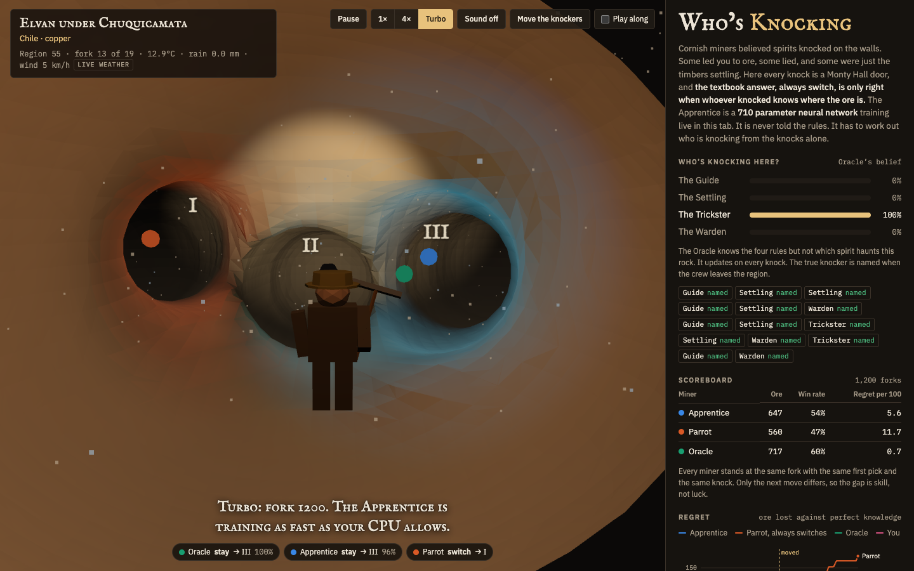

# Who's Knocking

An AI miner learns the Monty Hall problem the way it actually works: by figuring out **who opened the door**.



Everyone knows the answer to Monty Hall: always switch. But that answer is only right because the host **knows** where the car is and never opens it. If the host opens a door at random, switching is a coin flip. If the host only offers a switch when you already picked the car, switching always loses. Same open door, opposite meaning.

That is the whole problem of machine learning in one game show. Data does not tell you what it means. **The process that produced it does.**

## The scenario

Cornish tin miners believed in *knockers*: spirits that knocked on the mine walls. Some knocked to lead you to ore. Some knocked to warn you off a cave in. Some were tricksters. And the skeptics said it was just timbers settling and air popping in the rock.

Those four explanations are four Monty Halls.

| Knocker | Monty variant | When it knocks | Right move |
|---|---|---|---|
| **The Guide** | Monty Hall | Knows the seam. Always knocks an empty tunnel you did not pick. | Switch (wins 2/3) |
| **The Settling** | Monty Fall | Timbers settle at random, sometimes right on the seam and bury it. | Coin flip |
| **The Trickster** | Monty from Hell | Only when your pick is already the seam, to lure you off it. | Stay on a knock, switch on silence |
| **The Warden** | Angelic Monty | Only when your pick is wrong, sealing the other empty tunnel. | Switch on a knock, stay on silence. Never miss. |

The mine is split into regions. Each region is one kind of rock with one knocker haunting it, and nobody is told which. At every fork the crew draws lots for a tunnel, then a knock comes (or doesn't), and every miner decides: stay or switch.

### The miners

All of them stand at **the same fork, with the same first pick and the same knock**. Only the next move differs, so the gap between them is skill, not luck.

- **Oracle**: exact Bayesian inference. Knows the four rules, never which knocker is here. The ceiling.
- **Apprentice**: a 710 parameter neural network that starts knowing nothing. Never told the rules or the names. It sees the raw events of recent forks, the rock, and the weather, and learns from what the seam turns out to be.
- **Parrot**: always switches when it hears a knock. The memorized textbook answer, and a stand-in for a model that pattern matches a famous puzzle instead of reasoning about it.
- **You**: tick *Play along* and make the call yourself.

## How the model is tested, continuously

Because we wrote the world, we always know the exact right answer at every fork. That turns every fork into a free, labeled test, live, forever.

| Check | What it catches |
|---|---|
| **Regret against perfect knowledge** | Expected ore lost versus someone who knew the knocker. Computed from exact odds, not noisy outcomes. Flat line means learned. |
| **Canaries** | Six fixed probe forks, tested every ten forks and never trained on. Each is a history only one knocker could have produced. Named for the birds miners carried as a live test. |
| **Calibration error** | When it says 70%, does it win 70% of the time? |
| **Weather sway** | The same fork replayed under every other mine's weather. Weather never matters, so a good learner drives this to zero. |
| **Migration recovery** | Every so often the knockers move to different rocks. The rock is a strong cue that suddenly points the wrong way. How many forks until the Apprentice recovers? |
| **CI gates** | `npm test` checks the backprop against finite differences and fails if the Apprentice stops learning. `pytest` checks the Python port bit for bit. `python -m whos_knocking.evaluate --max-regret` gates any agent. |

### What it has shown so far

Measured headless, 8,000 forks, knockers moving every 2,500:

| Forks | Apprentice regret per 100 | Parrot | Oracle |
|---|---|---|---|
| 500 | 7.48 | 13.93 | 0.20 |
| 1,000 | 0.53 | 10.90 | 0.00 |
| 2,000 | 0.07 | 11.80 | 0.00 |
| 4,000 (after a move) | 1.50 | 9.80 | 0.07 |
| 8,000 | 0.97 | 14.20 | 0.10 |

It recovered from each migration in 196 to 300 forks.

Two lessons came out of building the tests, and both are real ML lessons:

1. **A canary you have not checked is not a test.** The first version of the probes passed no rock and zero weather. That never happens in real play, so the probes were out of distribution and two of six were "dead" for reasons that had nothing to do with whether the model understood the knockers. Asking each probe under every rock and every real mine's weather fixed it, and every canary now lives 93% to 100% of the time.
2. **The model does lean on the weather.** Changing only the weather moved its answer. The rain above a mine in Bolivia has nothing to do with spirits in the rock, but the network found a correlation anyway. That is why weather sway is on the live screen.

## Where the randomness comes from

Cloudflare keeps a wall of lava lamps in its lobby and hashes photos of it into random numbers. Same idea here, with free public sources:

- **drand**, the public randomness beacon run by the League of Entropy (Cloudflare runs a node). A new verifiable random value every 3 seconds.
- **The live weather above eight historic mines** (Botallack, Kiruna, Cerro Rico, Kalgoorlie, Butte, Wieliczka, Chuquicamata, Falun) from Open-Meteo.

Each region's seed is SHA-256 of the beacon round plus the weather. Hashing matters: raw weather is not uniform, and the Monty Hall odds are only exact if the dice are fair. The weather also shapes how the cave looks (drips from rain, fog from humidity, dust drifting with the wind, rock warmed by temperature) and is fed to the Apprentice as a deliberate red herring. Every seed is logged with its round, so anyone can refetch it and replay the cave exactly.

## Run it

No build step, no dependencies, no keys.

```sh
cd web && python3 -m http.server 8000
# open http://localhost:8000
# http://localhost:8000/#turbo   trains as fast as your CPU allows
# http://localhost:8000/#play    you play along
```

Tests:

```sh
npm test                                   # js: odds, backprop gradient check, learning gate
cd python && pip install -e ".[test]" && pytest
```

## Bring your own agent

The world is ported to Python as a [Gymnasium](https://gymnasium.farama.org) environment. One step is one fork: action 0 stays, 1 switches, reward 1 for ore. The observation matches the browser model's input exactly.

```python
from whos_knocking.env import KnockersEnv

env = KnockersEnv(episode_forks=2000)
obs, info = env.reset(seed=0)
obs, reward, terminated, truncated, info = env.step(1)
info["regret"]   # ore lost versus perfect knowledge
```

Score it the same way the live screen does:

```sh
python -m whos_knocking.evaluate --policy parrot --forks 3000 --seeds 5
python -m whos_knocking.evaluate --policy my_pkg.agents:MyAgent --max-regret 2
```

A policy is any class with `act(obs)` and `observe(obs, action, reward, info, next_obs)`.

## Cost

Zero. The network trains on the viewer's CPU in plain JavaScript with hand written backprop, Adam and a replay buffer. No server, no GPU, no API keys, no LLM calls. drand and Open-Meteo are free. The site can be hosted on GitHub Pages for free.

## Layout

```
web/sim.js          the world, the four knockers, the exact oracle
web/apprentice.js   the neural network, its canaries
web/expedition.js   runs all miners at the same forks, keeps the scorecard
web/entropy.js      drand + weather + sha-256
web/cave.js         three.js marching cubes cave
web/main.js         the live screen
python/             gymnasium env, bit for bit port, evaluator
tests/              node tests and the golden trace python must match
```

## Ideas

- More knockers: a Liar whose knocks are right only 70% of the time, or one that copies whichever knocker came before it.
- Let the Apprentice see a rolling memory across regions so it can notice migrations by itself.
- Chat votes as a fourth miner on a live stream.
- A recurrent network over the raw sequence instead of pooled counts, and a race between the two.

## Credits

[three.js](https://threejs.org) and its MarchingCubes addon, [simplex-noise](https://github.com/jwagner/simplex-noise.js), [drand](https://drand.love) and the League of Entropy, [Open-Meteo](https://open-meteo.com). Monty Fall is from Jeffrey Rosenthal's *Monty Hall, Monty Fall, Monty Crawl*. The knockers are from Cornish mining folklore.

## License

MIT
